 

Recife, Brazil · B.Sc. Computer Science (UFRPE) · PT (native) · EN (EF SET C2) · ES

## About

3+ years building production systems: web, mobile, backend and AI. I work spec-first with Claude Code and review everything that ships.

## What I do

I like the space between product and infrastructure. I've shipped 25+ web apps end to end, built systems that hundreds of businesses run on and plug into their flows, and helped untangle apps with 100K+ downloads.

Lately I'm building WhatsApp agents with MCP and RAG, self-initiated projects and studying AWS and AI Engineering.

## Stack

 

## Contact

Open to full stack and AI engineering roles.

